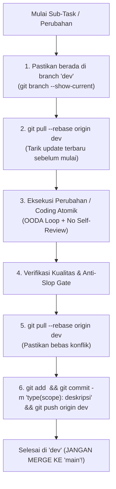

# Workflow: Git Branching & Continuous Dev Auto-Push Protocol (`dev` vs `main`)

> **Mandatory Git Discipline (`C-GIT`)**: Protokol resmi manajemen cabang Git untuk **NikahPlan Studio (`wedding-plan`)** dengan repositori `https://github.com/AhmadArifff/wedding-plan.git`.

---

## 1. Kebijakan Mutlak Dua Cabang (`dev` vs `main`)

1. **Cabang `dev` (Active Development Branch)**:
   - Seluruh pengembangan fitur, pembuatan skema database, perbaikan bug, dan penyempurnaan dokumen dilakukan di cabang `dev`.
   - **Kewajiban Auto-Push per Perubahan**: Setiap perubahan atau sub-tugas yang selesai wajib langsung di-commit secara atomik dengan pesan commit yang jelas dan langsung di-push ke `origin dev` (`git push origin dev`) agar riwayat progres di GitHub selalu terpantau jelas.
2. **Cabang `main` (Production Release Branch — DILARANG MERGE OTOMATIS)**:
   - Cabang `main` dikhususkan untuk rilis produksi (`prod`).
   - **LARANGAN MUTLAK**: Agen AI **DILARANG KERAS** melakukan `git checkout main && git merge dev` atau mendorong perubahan pengembangan langsung ke `main`.
   - Proses *merge* atau *Pull Request* dari `dev` ke `main` **HANYA dilakukan secara manual oleh pemilik proyek (User)**.

---

## 2. Alur Sinkronisasi Git di Cabang `dev`



---

## 3. Standar Format Pesan Commit (Conventional Commits)

Agar histori commit di cabang `dev` rapi, mudah dilacak, dan siap direview sebelum pengguna melakukan manual merge ke `main`, gunakan format:

- `feat(budget): add inline spreadsheet editing and gold mahar diff calculation`
- `feat(vendors): implement 5-status decision matrix and optional deal sync modal`
- `feat(kitchen): add guest portion multiplier and kitchen ingredient calculator`
- `feat(invitation): build block-based invitation editor and QRIS digital envelope`
- `feat(db): add Supabase RLS policies, financial summary view, and gold sync RPC`
- `fix(security): enforce rate limiting and quota check on public RSVP endpoint`
- `docs(prd): update frontend and backend product requirement specifications`
- `chore(agents): update session-state and local governance rules`

---

## 4. Perintah Baku Eksekusi Agen

```bash
# 1. Pastikan selalu berada di branch dev
git checkout dev

# 2. Tarik perubahan terbaru sebelum bekerja
git pull --rebase origin dev

# 3. Setelah perubahan terverifikasi, commit & langsung push ke origin dev
git add <file-yang-diubah>
git commit -m "<type>(<scope>): <deskripsi jelas perubahan>"
git push origin dev
```
