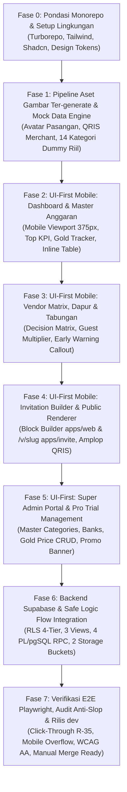

# Pelan Pengembangan Bertahap (Development Plan) — NikahPlan Studio

| Informasi Dokumen | Detail |
| :--- | :--- |
| **Nama Proyek** | NikahPlan Studio (Wedding Planner, Financial Insight & Digital Invitation SaaS) |
| **Strategi Inti** | **UI-First Slicing** dengan data dummy riil -> **Mobile-First Priority** (375px) -> **Aset Gambar Ter-generate** (Zero Stock Photo) -> **Integrasi Backend Supabase** |
| **Cabang Git** | `dev` (Commit atomik & auto-push `origin dev`; DILARANG auto-merge ke `main`) |
| **Dokumen Acuan** | [PRD.md](./PRD.md) · [PRD-FRONTEND.md](./PRD-FRONTEND.md) · [PRD-BACKEND.md](./PRD-BACKEND.md) · [.agents/session-state.json](./.agents/session-state.json) |

---

## 1. Peta Jalan & Matriks Tahapan Pengembangan (Roadmap Matrix)

---

## 2. Rincian Milestone & Sub-Tugas Pelacakan (Phased Milestones)

---

### 🟢 Fase 0: Pondasi Monorepo & Konfigurasi Ekosistem
**Fokus**: Membangun kerangka kerja Turborepo yang bersih, paket bersama (`packages/ui`, `packages/db`, `packages/invitation-blocks`), dan pengaturan styling.

- [x] **M0.1 — Inisialisasi Turborepo Monorepo**:
  - Konfigurasi `turbo.json`, `package.json` root pnpm/npm workspace.
  - Setup folder `apps/web` (Next.js App Router) dan `apps/invite` (Next.js lightweight renderer).
  - Setup `packages/ui` (Design System bersama), `packages/db` (Typed contracts & DTOs), `packages/invitation-blocks` (Blok undangan).
- [x] **M0.2 — Setup Tailwind CSS, Token Desain & Font**:
  - Konfigurasi token warna *Warm Editorial Financial Clarity* (`#FAF8F5`, `#FFFFFF`, `#1C1917`, `#0F766E`, `#B45309`, `#BE123C`).
  - Setup font Google via `next/font`: `Cormorant Garamond` (heading editorial) & `Plus Jakarta Sans` (sans & tabular-nums).
- [x] **M0.3 — Inisialisasi Primitif UI & Motion**:
  - Pasang dependensi `motion` (Framer Motion), `animejs`, `@animate-ui`, Radix UI / Shadcn UI primitives.
- **Reviewer Gate**: `tech-critic` memverifikasi struktur monorepo tidak memiliki siklus dependensi (*no circular dependencies*).

---

### 🟢 Fase 1: Pipeline Aset Gambar Ter-generate & Mock Data Engine
**Fokus**: Menyediakan seluruh aset visual kustom (tanpa comot internet) dan dataset dummy pernikahan Indonesia yang realistis.

- [x] **M1.1 — Pembuatan Engine Data Dummy Realistis Pernikahan Indonesia**:
  - File `packages/ui/src/mock/wedding-dummy-data.ts`:
    - Profil pasangan: Ahmad Arif, S.Kom & Siti Rahmawati, S.Pd (Target nikah: 14 Nov 2027).
    - 14 Kategori Master Anggaran & 32 item pengeluaran riil (Total: `Rp 81.170.000`).
    - Item Mahar Emas 10 gram (Anggaran: `Rp 1.350.000/gr`, Pasar: `Rp 1.420.000/gr`, Selisih: `+Rp 700.000`).
    - 18 Kandidat Vendor lintas 5 status (`DEAL`, `DISCUSSION`, `CANDIDATE`, `REJECTED`, `ARCHIVED`).
    - 7 Komponen Dapur Mandiri (300 Tamu / 600 Porsi, Total: `Rp 13.620.000` -> `Rp 45.400/tamu`).
    - Rekening Amplop BCA & Mandiri, serta simulasi ucapan buku tamu riil.
- [x] **M1.2 — Generasi Aset Gambar Kustom (Zero Stock Photo Internet)**:
  - Generate avatar mempelai pria & wanita berbusana adat modern (`avatar-groom.webp`, `avatar-bride.webp`).
  - Generate 3 cover tema undangan digital (`theme-javanese-heritage.webp`, `theme-botanical-sage.webp`, `theme-minimal-editorial.webp`).
  - Generate gambar kode QRIS Merchant resmi tajam (`qris-merchant-dummy.png`) atas nama *"NikahPlan - Arif & Siti Wedding"*.
  - Generate ilustrasi vektor logam mulia koin/emas batangan (`gold-mahar-illustration.svg`).
  - Simpan seluruh file di `packages/ui/assets/generated/` dan mirror ke `apps/web/public/generated/` serta `apps/invite/public/generated/`.
- **Reviewer Gate**: `qa-engineer` memverifikasi seluruh aset tersimpan lokal, rasio tajam, dan tidak ada hotlink ke domain luar.

---

### 🟢 Fase 2: UI-First Mobile: Dashboard & Master Anggaran (`apps/web`)
**Fokus**: Membangun tampilan utama pengantin di viewport ponsel (`375px`), lalu diadaptasi ke desktop.

- [x] **M2.1 — Mobile Shell & Bottom Navigation**:
  - Header ramping dengan judul rencana, status sisa trial Pro 30 hari, dan toggle akun.
  - Bottom Navigation Bar ergonomis (Tab: Anggaran, Vendor, Dapur, Tabungan, Undangan) dengan tap target $\ge 44\text{px}$.
- [x] **M2.2 — Widget Pengingat Harga Emas Harian & Banner Selisih**:
  - Komponen `LiveGoldPriceWidget` di atas tabel: menampilkan harga pasar hari ini vs anggaran pengguna.
  - Notifikasi selisih emas mahar (`+Rp 700.000`) & tombol interaktif *"Sesuaikan ke Harga Emas Hari Ini"*.
  - Popover konfirmasi 1-klik dengan animasi sliding counter angka saat disetujui.
- [x] **M2.3 — Top KPI Metric Cards (Swipeable Carousel di Mobile -> 4 Kolom di Desktop)**:
  - Total Semua Anggaran (`Rp 81.170.000`), Tamu & Porsi (`300 / 600`), Biaya Dapur per Tamu (`Rp 45.400`), Komitmen Vendor Deal (`Rp 42.500.000`).
- [x] **M2.4 — Tabel Master Anggaran (Single Unified Table & Pure Numeric)**:
  - Kolom kategori collapsible dengan subtotal masing-masing.
  - *Pure Numeric Typography*: Angka nominal rata kanan tabular-nums tanpa teks `"Rp "` berulang di dalam sel.
  - *Inline Editing Spreadsheet*: Mode klik / tap sel langsung berubah menjadi input dengan kontrol simpan `Enter` / batal `Escape`. Di ponsel, mendukung tap sel untuk membuka mini edit sheet.
  - Filter bar: `Semua Kategori`, `Tanpa Kategori (Unassigned)`, dan pencarian item kebutuhan.
  - Sticky bottom footer dengan `TOTAL AKUMULASI ANGGARAN`.
- **Reviewer Gate**: `ui-ux-designer` memverifikasi kontras WCAG AA, bebas em-dash (`R-02`), dan tidak ada horizontal scrollbar ganda (`Rule 31`).

---

### 🟢 Fase 3: UI-First Mobile: Decision Matrix Vendor, Dapur Mandiri & Tabungan
**Fokus**: Menyelesaikan antarmuka komparasi vendor, kalkulator dapur porsi, dan simulator tabungan *minim budget*.

- [ ] **M3.1 — Modul Seleksi & Decision Matrix Vendor**:
  - Kartu metrik: Total Vendor, Terpilih (Deal), Total Biaya Deal, Dalam Review.
  - Tampilan kartu vendor ramah ponsel dengan badge 5 status seleksi.
  - Transisi status vendor menggunakan spring physics (`motion`).
  - Modal / Slide-Over Konfirmasi Sinkronisasi saat status diubah menjadi `Deal / Terpilih` (opsi: sinkronkan ke anggaran vs simpan status saja — *Full User Autonomy*).
- [ ] **M3.2 — Modul Tamu & Kalkulator Dapur Mandiri**:
  - Stepper sentuh Tamu Laki-laki dan Perempuan dengan tombol plus/minus besar.
  - Pilihan faktor pengali porsi masak (`1.5x`, `2.0x`, `Kustom`).
  - Kartu efisiensi: Total Biaya Dapur, Biaya Makan per Tamu, dan Biaya per Porsi.
  - Tabel rincian belanja 7 bahan pokok dapur dengan inline subtotal calculation.
- [ ] **M3.3 — Modul Perencanaan Tabungan & Early Warning**:
  - Input interaktif Tabungan Saat Ini & Kapasitas Menabung Bulanan.
  - Progress bar terukur persentase dana terkumpul dan hitung mundur bulan tercapai.
  - Peringatan Dini (*Early Warning Callout*) jika vendor melebihi plafon kategori atau kenaikan harga emas mahar menggeser target waktu menabung.
- **Reviewer Gate**: `qa-engineer` memverifikasi seluruh rumus matematika finansial bekerja akurat secara interaktif di sisi client.

---

### 🟢 Fase 4: UI-First Mobile: Digital Invitation Builder & Public Renderer (`apps/invite`)
**Fokus**: Editor blok visual undangan di `apps/web` dan halaman publik undangan berkecepatan tinggi di `/v/[slug]`.

- [ ] **M4.1 — Visual Block Editor Undangan (`apps/web`)**:
  - Panel konfigurasi blok: Pilihan tema, Informasi Mempelai, Waktu/Lokasi Acara, Amplop Digital, Form RSVP.
  - Live Mobile Preview Frame (`375x812px`) interaktif dengan simulasi tampilan nyata.
- [ ] **M4.2 — Halaman Publik Undangan Digital (`apps/invite` `/v/[slug]`)**:
  - Layar sampul amplop terpersonalisasi (`?to=Nama+Tamu`) dengan animasi unsealing reveal (`animejs` + `motion`).
  - Desain editorial heritage yang mengalir mulus saat di-scroll di ponsel kelas menengah ke bawah.
- [ ] **M4.3 — Fitur Amplop Digital (Transfer Bank & QRIS Merchant)**:
  - Kartu nomor rekening bank dengan tombol *"Salin Nomor Rekening"* yang memicu animasi centang dan toast konfirmasi.
  - Modal / Sheet perbesar gambar kode **QRIS Merchant** ter-generate lengkap dengan tombol unduh gambar.
- [ ] **M4.4 — Form RSVP & Buku Tamu Interaktif**:
  - Input kehadiran (Hadir/Ragu/Tidak), jumlah pax tamu, dan teks ucapan doa selamat dengan kartu animasi ucapan.
- **Reviewer Gate**: `user-test-professional` memverifikasi kemudahan tamu lanjut usia dalam menyalin nomor rekening dan memindai QRIS di smartphone.

---

### 🟢 Fase 5: UI-First: Super Admin Portal & Manajemen Pro Trial
**Fokus**: Portal admin internal untuk mengelola data master dinamis dan kampanye promosi.

- [ ] **M5.1 — Master Data Management UI**:
  - CRUD Kategori Standar Pernikahan (tambah kategori, ubah urutan sort, edit plafon default).
  - CRUD Daftar Bank Nasional & E-Wallet (logo, nama bank, kode transfer).
  - CRUD Acuan Harga Emas Harian (input harga per gram hari ini, tanggal efektif, catatan sumber).
  - CRUD Template Tema Undangan (upload thumbnail cover ter-generate, konfigurasi token warna & font).
- [ ] **M5.2 — Manajemen Subscription & Marketing Trial**:
  - Pengaturan durasi *Auto-Trial Pro Plan* saat registrasi (default: 30 hari).
  - Pembuat Kode Promo perpanjangan masa trial (diskon hari tambahan, batas maksimal pemakaian, tanggal kedaluwarsa).
  - Pemantauan daftar workspace pengguna dan sisa hari trial.
- **Reviewer Gate**: `policy-schema-enforcer` memverifikasi Zero Hardcoded Master Data Policy terpenuhi 100%.

---

### 🟢 Fase 6: Integrasi Backend Supabase, Database Engine & Keamanan RLS
**Fokus**: Mengalirkan data nyata dari mock layer ke Supabase PostgreSQL, Views, RPC, dan Storage Buckets.

- [ ] **M6.1 — Skema Migrasi SQL & RLS 4-Tier**:
  - Eksekusi file DDL migrasi tabel `workspaces`, `budget_*`, `vendors`, `kitchen_*`, `savings_*`, `invitations`, `master_*`.
  - Terapkan kebijakan Row-Level Security 4-tier (`SUPER_ADMIN`, `OWNER`, `EDITOR`, `VIEWER_KITCHEN`).
- [ ] **M6.2 — Implementasi 3 Database Views**:
  - `v_workspace_financial_summary`: Sumber data Top KPI dan rumus finansial pre-compiled.
  - `v_vendor_decision_matrix`: Logika deteksi over-budget plafon vendor.
  - `v_public_invitation_safe`: Barrier isolasi data publik `/v/[slug]` (0 byte kebocoran data pribadi/anggaran).
- [ ] **M6.3 — Implementasi 4 PL/pgSQL Stored Procedures (`SECURITY DEFINER`)**:
  - `rpc_bootstrap_new_workspace`: Inisialisasi otomatis workspace dan trial 30 hari saat sign-up.
  - `rpc_sync_gold_mahar_price`: Update harga emas mahar atomik dengan audit log.
  - `rpc_sync_vendor_deal_to_budget`: Transaksi atomik status Deal dan penyesuaian anggaran.
  - `rpc_redeem_promo_code`: Klaim kode promo dengan penguncian baris `FOR UPDATE` anti-race condition.
- [ ] **M6.4 — Storage Buckets & Supabase Cron Keep-Alive**:
  - Setup bucket `public-invitation-assets` dan `private-workspace-docs`.
  - Setup route `/api/cron/supabase-keepalive` anti-auto-pause.
- **Reviewer Gate**: `security-engineer` memverifikasi tidak ada celah IDOR dan kebocoran data anggaran pada `/v/[slug]`.

---

### 🟢 Fase 7: Pengujian E2E Playwright, Audit Anti-Slop & Serah Terima
**Fokus**: Memvalidasi seluruh alur klik nyata, performa mobile, dan kepatuhan pengiriman.

- [ ] **M7.1 — Automated Playwright Click-Through Testing (`R-35`)**:
  - Test skenario mobile 375px: Registrasi -> Dashboard -> Edit harga anggaran -> Sinkronisasi harga emas -> Ubah status vendor -> Ubah tamu dapur -> Buka undangan publik `/v/slug` -> Salin rekening & submit RSVP.
- [ ] **M7.2 — Audit Anti-Slop 4-Blok (Delivery Gate)**:
  - Blok 1: Bebas em-dash (`R-02`), bebas mobile overflow (`R-03`), data riil (`R-17`), tanpa link mati (`R-26`), WCAG AA ($\ge 4.5:1$).
  - Blok 2: Purpose-Gate seluruh efek visual (`R-31`).
  - Blok 3: Kepatuhan Liveliness Dials (`ENERGY 2` di Studio, `ENERGY 3` di Undangan).
  - Blok 4: Craftsmanship Standards (C-1 s.d C-5).
- [ ] **M7.3 — Final Dev Push & Serah Terima ke Pemilik Proyek**:
  - Seluruh commit tersusun rapi di branch `dev` dan di-push ke `origin dev`.
  - Siap untuk di-merge manual oleh pemilik proyek ke branch `main`.

---

## 3. Protokol Pembaruan Status Progres

Setiap kali sub-tugas dalam fase ini diselesaikan:
1. Perbarui status checkbox di dokumen ini (`[ ]` -> `[x]`).
2. Sinkronkan objek `active_subtask` dan `subtasks` di [`.agents/session-state.json`](./.agents/session-state.json).
3. Buat Conventional Commit yang relevan (misal `feat(budget-ui): implement mobile-first spreadsheet table with dummy data`).
4. Langsung jalankan `git push origin dev` (tanpa merge ke `main`).

