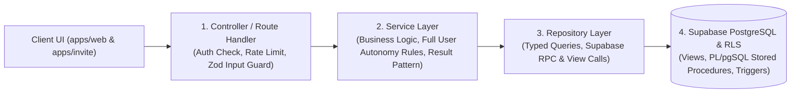

# Product Requirements Document: Backend Logic Flow, Database Optimization & Security (`PRD-BACKEND.md`)

| Informasi Dokumen | Detail |
| :--- | :--- |
| **Nama Proyek** | NikahPlan Studio (Wedding Planner, Financial Insight & Digital Invitation SaaS) |
| **Dokumen Terkait** | [PRD.md](./PRD.md) (Core Architecture) · [PRD-FRONTEND.md](./PRD-FRONTEND.md) (Frontend UI/UX & Anti-Slop) |
| **Cakupan Sistem** | `packages/db` (Supabase Schema, Views, PL/pgSQL RPC, RLS, Migrations) · Backend Services & API Routes (`apps/web/src/server` / `apps/api`) |
| **Tech Stack Backend** | Supabase PostgreSQL, Supabase Auth & RLS, Supabase Storage Buckets, Prisma / Typed SQL Client, Upstash Redis (Rate Limiting & Atomic Locks), Zod Validation, TypeScript |
| **Fokus Utama** | Safe Logic Flow (Guard Clauses & Result Pattern), Maximized Database Engine (Views, Stored Procedures/RPC, Exact Decimal Math), Zero Data Leakage & OWASP Defense-in-Depth |

---

## 1. Arsitektur Logic Flow & Ketahanan Backend (Zero Unhandled Error)

Dokumen ini mendefinisikan standar rekayasa backend dan basis data untuk **NikahPlan Studio** guna memastikan seluruh kalkulasi finansial akurat 100%, tidak ada kebocoran data lintas pasangan pengantin (*Zero Cross-Tenant Data Leak*), dan tidak ada error runtime liar yang merusak pengalaman pengguna.

### 1.1. Arsitektur Berlapis (*4-Layer Clean Architecture*)

Seluruh logika backend di `apps/web` dan `packages/db` wajib mematuhi pemisahan tanggung jawab berikut:



1. **Controller / Route Handler / Server Action**:
   - Hanya bertugas memverifikasi sesi autentikasi, menjalankan rate-limiting (Upstash Redis), memvalidasi skema payload dengan `Zod`, dan meneruskan ke Service Layer. Dilarang menulis query database di lapisan ini.
2. **Service Layer**:
   - Menjalankan aturan bisnis (seperti kalkulasi *Early Warning* tabungan, pengecekan masa aktif `PRO_TRIAL`, dan penegakan kuota `FREE_PLAN`) serta mengembalikan objek `Result<T, AppError>`.
3. **Repository Layer**:
   - Mengisolasi seluruh pemanggilan ke tabel Supabase, Database Views (`v_...`), dan Stored Procedures (`rpc_...`).
4. **Database Engine Layer (PostgreSQL + RLS)**:
   - Menjadi benteng pertahanan terakhir melalui **Row-Level Security (RLS)**, *Foreign Key Constraints*, transaksi atomik `FOR UPDATE`, serta eksekusi *pre-compiled* di dalam PL/pgSQL RPC.

---

### 1.2. Standar Alur Logika Aman (*Safe Logic Flow Matrix*)

Untuk mengeliminasi *silent bugs* dan *unhandled exceptions*, seluruh fungsi backend wajib menerapkan 5 prinsip ini:

1. **Guard Clauses & Early Return**:
   - Validasi prasyarat (keberadaan sesi, hak akses role workspace, status masa aktif trial, validitas angka) wajib dilakukan di baris paling atas fungsi. Dilarang menggunakan `if-else` bersarang lebih dari 2 tingkat (*No Pyramid of Doom*).
2. **Standardized Result Pattern (`Result.ok` / `Result.fail`)**:
   - Service layer tidak boleh melempar *raw exception* untuk kegagalan logika bisnis. Gunakan kontrak baku:
     ```typescript
     export type ErrorCode =
       | 'ERR_UNAUTHORIZED'
       | 'ERR_FORBIDDEN_ROLE'
       | 'ERR_WORKSPACE_NOT_FOUND'
       | 'ERR_TRIAL_EXPIRED_FEATURE_LOCKED'
       | 'ERR_RSVP_QUOTA_REACHED'
       | 'ERR_PROMO_ALREADY_REDEEMED'
       | 'ERR_PROMO_EXPIRED'
       | 'ERR_INVALID_PAYLOAD'
       | 'ERR_CONCURRENCY_LOCK'
       | 'ERR_INTERNAL_SERVER';

     export interface Result<T> {
       isSuccess: boolean;
       data?: T;
       error?: {
         code: ErrorCode;
         message: string; // Pesan aman dan humanis untuk UI
         fieldErrors?: Record<string, string[]>;
       };
     }
     ```
3. **Global Exception Sanitizer (Anti-Information Disclosure)**:
   - Jika terjadi kesalahan tak terduga di tingkat database/jaringan, Global Error Handler wajib mencatat detail teknis lengkap (`userId`, `workspaceId`, `sqlState`, `stackTrace`) ke tabel `audit_logs` / logger server, namun **HANYA** mengembalikan respons generik yang aman ke client (`500 - Terjadi gangguan sistem sementara, silakan coba sesaat lagi`). Dilarang keras membocorkan nama tabel, query SQL, atau stack trace ke browser.
4. **Presisi Matematika Finansial (Zero Floating-Point Error)**:
   - Seluruh nilai mata uang Rupiah di database wajib disimpan sebagai `NUMERIC(15, 2)` atau `BIGINT` (satuan Rupiah utuh), dan berat emas mahar disimpan sebagai `NUMERIC(10, 3)` (mendukung ketelitian hingga `0.001 gram`).
   - Dilarang menggunakan tipe `FLOAT` atau `REAL` untuk menghindari bug pembulatan desimal IEEE 754.
5. **Logika Kendali Penuh Pengguna (*Full User Autonomy Logic*)**:
   - Backend tidak pernah mengunci atau menghapus baris anggaran pengguna secara paksa:
     - Saat harga emas harian (`master_gold_prices`) diperbarui oleh Super Admin, backend **TIDAK** mengubah `unit_price` di tabel `budget_items` milik pengguna secara diam-diam. Backend hanya menghitung selisih (`gold_price_diff`) melalui Database View. Perubahan `unit_price` hanya terjadi jika pengguna memanggil RPC `rpc_sync_gold_mahar_price`.
     - Saat status vendor di tabel `vendors` diubah menjadi `DEAL`, backend menyediakan parameter eksplisit `sync_to_budget: boolean`. Jika `false`, status vendor tetap tersimpan sebagai `DEAL` tanpa menyentuh nominal di tabel `budget_items`.
     - Saat masa `PRO_TRIAL` berakhir dan workspace turun ke `FREE`, seluruh operasi CRUD pada `budget_items`, `vendors`, `kitchen_items`, dan `savings_plans` **TETAP DIIZINKAN 100%**. Pembatasan hanya diterapkan pada endpoint Export PDF/Excel dan kuota/watermark publikasi undangan.

---

## 2. Desain Skema Database Maksimal (Supabase PostgreSQL)

### 2.1. Prinsip Zero Hardcoded Master Data

Sesuai standar enterprise, **DILARANG KERAS** meng-hardcode data master di dalam kode TypeScript/React. Seluruh referensi dikelola secara dinamis melalui tabel `master_*` yang dapat diubah oleh **Super Admin** kapan saja saat runtime:

1. `master_categories`: 14 kategori pengeluaran standar pernikahan (beserta urutan tampil, ikon SVG slug, dan flag `is_default`).
2. `master_banks`: Daftar bank nasional & e-wallet resmi (kode bank, nama bank, logo path di bucket publik) untuk fitur Amplop Digital.
3. `master_gold_prices`: Riwayat & harga acuan emas murni harian per gram (`price_per_gram`, `effective_date`, `source_note`, `updated_by`).
4. `master_invitation_themes`: Daftar template tema undangan digital beserta konfigurasi token JSON (`Design DNA`: palet warna, pasangan font, layout style, dan status `is_pro_only`).
5. `platform_trial_configs` & `promo_codes`: Konfigurasi durasi *Auto-Trial Pro Plan* (default: `30 hari`) dan daftar kode promo perpanjangan masa aktif trial.

---

### 2.2. Entity-Relationship Diagram (ERD)

```mermaid
erDiagram
    PROFILES ||--o{ WORKSPACE_MEMBERS : "has memberships"
    WORKSPACES ||--|{ WORKSPACE_MEMBERS : "grants access to"
    WORKSPACES ||--|| WORKSPACE_SUBSCRIPTIONS : "has subscription state"
    WORKSPACES ||--o{ BUDGET_CATEGORIES : "organizes"
    BUDGET_CATEGORIES ||--o{ BUDGET_ITEMS : "contains"
    WORKSPACES ||--o{ VENDORS : "evaluates"
    VENDORS ||--o{ BUDGET_ITEMS : "optionally linked to"
    WORKSPACES ||--|| KITCHEN_CONFIGS : "configures guest ratio"
    KITCHEN_CONFIGS ||--o{ KITCHEN_ITEMS : "calculates ingredients"
    WORKSPACES ||--|| SAVINGS_PLANS : "tracks target"
    WORKSPACES ||--o| INVITATIONS : "publishes (/v/slug)"
    INVITATIONS ||--o{ INVITATION_BLOCKS : "composed of"
    INVITATIONS ||--o{ INVITATION_ENVELOPES : "receives gifts via"
    INVITATIONS ||--o{ RSVP_WISHES : "collects guest RSVPs"
    MASTER_GOLD_PRICES ||--o{ BUDGET_ITEMS : "benchmarks gold mahar"
    PROMO_CODES ||--o{ PROMO_REDEMPTIONS : "extends trial via"

    PROFILES {
        uuid id PK "References auth.users(id)"
        string full_name
        string email
        string platform_role "USER | SUPER_ADMIN"
        timestamptz created_at
    }

    WORKSPACES {
        uuid id PK
        uuid owner_id FK
        string wedding_title "e.g. Pernikahan Arif & Siti"
        date target_wedding_date
        timestamptz created_at
        timestamptz deleted_at
    }

    WORKSPACE_MEMBERS {
        uuid id PK
        uuid workspace_id FK
        uuid user_id FK
        string member_role "OWNER | EDITOR | VIEWER_KITCHEN"
        timestamptz joined_at
    }

    WORKSPACE_SUBSCRIPTIONS {
        uuid id PK
        uuid workspace_id FK
        string plan_status "PRO_TRIAL | FREE | PRO_ACTIVE"
        timestamptz trial_starts_at
        timestamptz trial_ends_at
        timestamptz pro_expires_at
        int rsvp_quota_limit "Default 50 on FREE, Unlimited (-1) on PRO"
    }

    BUDGET_CATEGORIES {
        uuid id PK
        uuid workspace_id FK
        uuid master_category_id FK "Nullable for custom categories"
        string name
        int sort_order
        numeric ceiling_amount "Plafon anggaran kategori"
    }

    BUDGET_ITEMS {
        uuid id PK
        uuid workspace_id FK
        uuid category_id FK "Nullable (Supports Uncategorized filter)"
        uuid linked_vendor_id FK "Nullable"
        string item_name
        numeric quantity "Default 1"
        string unit_label "paket, gram, hari, porsi"
        numeric unit_price "NUMERIC(15,2)"
        numeric total_price "Generated: quantity * unit_price"
        boolean is_gold_mahar "True untuk item Mahar Emas"
        numeric gold_weight_grams "NUMERIC(10,3)"
        string price_source "MANUAL | VENDOR_SYNC | GOLD_SYNC"
        timestamptz updated_at
    }

    VENDORS {
        uuid id PK
        uuid workspace_id FK
        uuid category_id FK "Nullable (Supports Unassigned filter)"
        string vendor_name
        numeric quoted_price "NUMERIC(15,2)"
        string selection_status "DEAL | DISCUSSION | CANDIDATE | REJECTED | ARCHIVED"
        text comparison_notes
        string contact_info
        timestamptz updated_at
    }

    KITCHEN_CONFIGS {
        uuid id PK
        uuid workspace_id FK
        int male_guests "Tamu Laki-laki"
        int female_guests "Tamu Perempuan"
        numeric portion_multiplier "Default 2.0"
        int total_guests "Generated: male + female"
        int total_portions "Generated: (male + female) * multiplier"
    }

    KITCHEN_ITEMS {
        uuid id PK
        uuid workspace_id FK
        uuid kitchen_config_id FK
        string ingredient_name "Beras, Daging Sapi, dll"
        numeric quantity
        string unit_label "kg, ekor, paket, tim"
        numeric unit_price "NUMERIC(15,2)"
        numeric subtotal "Generated: quantity * unit_price"
        int sort_order
    }

    SAVINGS_PLANS {
        uuid id PK
        uuid workspace_id FK
        numeric current_savings_amount "Tabungan Saat Ini"
        numeric monthly_saving_capacity "Kapasitas Menabung Bulanan"
        timestamptz updated_at
    }

    INVITATIONS {
        uuid id PK
        uuid workspace_id FK
        uuid theme_id FK
        string slug UK "Unique URL /v/[slug]"
        boolean is_published
        string groom_nick
        string groom_full_name
        string bride_nick
        string bride_full_name
        timestamptz akad_datetime
        timestamptz reception_datetime
        string venue_name
        text venue_address
        string google_maps_url
        timestamptz updated_at
    }

    INVITATION_ENVELOPES {
        uuid id PK
        uuid invitation_id FK
        uuid master_bank_id FK "Nullable if QRIS"
        string envelope_type "BANK_TRANSFER | QRIS_MERCHANT"
        string account_number
        string account_holder_name
        string qris_storage_path "Relative path in public-invitation-assets"
        boolean is_active
        int sort_order
    }

    RSVP_WISHES {
        uuid id PK
        uuid invitation_id FK
        string guest_name
        string attendance_status "ATTENDING | NOT_ATTENDING | TENTATIVE"
        int pax_count
        text wish_message
        boolean is_approved
        string ip_hash "Hashed IP for anti-spam rate limit"
        timestamptz created_at
    }
```



---

### 2.3. Penanganan Filter `NULL` / `Unassigned` Tanpa Miskonsepsi

Untuk mencegah bug di mana pengguna membuat item anggaran atau kandidat vendor tanpa memilih kategori lalu item tersebut "hilang" saat difilter:
1. Kolom `category_id` pada `budget_items` dan `vendors` menggunakan `ON DELETE SET NULL`.
2. Query Repository wajib mendukung 3 mode filter secara eksplisit:
   - `filter = 'ALL'` -> Mengambil seluruh baris milik `workspace_id` (`WHERE workspace_id = $1 AND deleted_at IS NULL`).
   - `filter = 'UNASSIGNED'` -> Mengambil khusus baris tanpa kategori (`WHERE workspace_id = $1 AND category_id IS NULL AND deleted_at IS NULL`).
   - `filter = '<uuid>'` -> Mengambil kategori spesifik (`WHERE workspace_id = $1 AND category_id = $2 AND deleted_at IS NULL`).

---

## 3. Pemaksimalan Fitur Database: Views (`v_...`) & Stored Procedures (`rpc_...`)

Sesuai blueprint optimasi database enterprise, logika agregasi multi-tabel dan transaksi sensitif dijalankan langsung di engine PostgreSQL agar **pre-compiled, bebas N+1 query, dan dijamin atomik (ACID)**.

### 3.1. Tiga Database Views Utama (`CREATE VIEW`)

#### 1. `v_workspace_financial_summary` (Sumber Data Top KPI Cards & Insight Finansial)
Menggabungkan 6 tabel dalam satu kali pembacaan terindeks untuk menyediakan:
- `total_budget_amount`: Jumlah seluruh `budget_items.total_price` di workspace.
- `total_deal_vendor_amount` & `deal_vendor_count`: Akumulasi `vendors.quoted_price` yang berstatus `'DEAL'`.
- `total_guests` & `total_portions`: Diambil dari `kitchen_configs`.
- `total_kitchen_cost` & `kitchen_cost_per_guest`: Akumulasi `kitchen_items.subtotal` dibagi `NULLIF(total_guests, 0)`.
- `latest_gold_price_per_gram`: Harga emas terbaru dari `master_gold_prices`.
- `gold_mahar_variance_amount`: Selisih antara `(latest_gold_price_per_gram * gold_weight_grams)` dengan `total_price` item mahar emas yang tercatat saat ini di anggaran pengguna.
- `savings_deficit_amount`: `GREATEST(0, total_budget_amount - current_savings_amount)`.
- `estimated_saving_months`: `CEIL(savings_deficit_amount / NULLIF(monthly_saving_capacity, 0))`.
- `effective_plan_status` & `trial_days_remaining`: Menghitung secara real-time apakah `PRO_TRIAL` masih aktif (`NOW() < trial_ends_at`) atau sudah otomatis turun menjadi `FREE` tanpa perlu menunggu cron job.

#### 2. `v_vendor_decision_matrix` (Komparasi Objektif & Early Warning Vendor)
- Menghitung selisih harga penawaran setiap vendor (`quoted_price`) terhadap plafon kategori (`budget_categories.ceiling_amount`) atau baris anggaran terkait.
- Menghasilkan flag boolean `is_over_ceiling` (`quoted_price > ceiling_amount`) untuk memicu peringatan dini (*Early Warning*) di halaman Tabungan & Vendor.

#### 3. `v_public_invitation_safe` (Barrier Isolasi Data Publik `/v/[slug]`)
> [!CAUTION]
> **Benteng Pencegahan Kebocoran Data**: Aplikasi publik `apps/invite` (`/v/[slug]`) **DILARANG KERAS** melakukan query langsung ke tabel `workspaces`, `budget_items`, `savings_plans`, atau `profiles`.
- `v_public_invitation_safe` hanya memproyeksikan kolom-kolom publik dari `invitations` (yang berstatus `is_published = true`), blok susunan acara dari `invitation_blocks`, nomor rekening/QRIS aktif dari `invitation_envelopes`, serta status apakah watermark ditampilkan (`show_watermark = (effective_plan_status = 'FREE')`).
- Dengan arsitektur ini, meskipun seseorang mencoba menginspeksi response network di halaman `/v/[slug]`, **0 byte data anggaran, tabungan, maupun nomor telepon pribadi pemilik akun yang ikut terkirim**.

---

### 3.2. Empat Stored Procedures / Supabase PL/pgSQL RPC (`SECURITY DEFINER`)

Seluruh fungsi RPC yang menggunakan `SECURITY DEFINER` **WAJIB** menyertakan `SET search_path = public, pg_temp` (mencegah *search_path hijacking*) dan memverifikasi `auth.uid()` secara eksplisit di baris pertama:

#### 1. `rpc_bootstrap_new_workspace(p_wedding_title TEXT, p_target_date DATE)`
- **Tujuan**: Menyiapkan workspace pengguna baru secara atomik saat registrasi selesai.
- **Alur Transaksi**:
  1. Membaca durasi trial aktif dari tabel `platform_trial_configs` (default `30 hari`).
  2. Membuat baris baru di `workspaces` dan mendaftarkan `auth.uid()` sebagai `OWNER` di `workspace_members`.
  3. Membuat baris di `workspace_subscriptions` dengan `plan_status = 'PRO_TRIAL'`, `trial_starts_at = NOW()`, dan `trial_ends_at = NOW() + (v_trial_days || ' days')::INTERVAL`.
  4. Mengkloning 14 kategori pengeluaran standar dari `master_categories` ke `budget_categories` milik workspace tersebut serta menginisialisasi 7 bahan pokok standar di `kitchen_items` secara idempoten (`ON CONFLICT DO NOTHING`).

#### 2. `rpc_sync_gold_mahar_price(p_workspace_id UUID, p_budget_item_id UUID)`
- **Tujuan**: Eksekusi tombol *"Sesuaikan ke Harga Emas Hari Ini"* secara atomik.
- **Alur Transaksi**:
  1. Guard Clause: Memastikan `auth.uid()` memiliki peran `OWNER` atau `EDITOR` di `p_workspace_id`.
  2. Mengunci baris item mahar (`SELECT ... FROM budget_items WHERE id = p_budget_item_id AND workspace_id = p_workspace_id FOR UPDATE`).
  3. Mengambil harga emas terbaru dari `master_gold_prices`.
  4. Memperbarui `unit_price = v_latest_gold_price` dan `price_source = 'GOLD_SYNC'`.
  5. Mencatat harga sebelum dan sesudah perubahan ke dalam `audit_logs`.

#### 3. `rpc_sync_vendor_deal_to_budget(p_workspace_id UUID, p_vendor_id UUID, p_budget_item_id UUID, p_sync_price BOOLEAN)`
- **Tujuan**: Mengubah status vendor menjadi `'DEAL'` dan (jika `p_sync_price = true`) menyinkronkan harga penawaran vendor ke baris Master Anggaran terkait dalam satu transaksi database.
- **Alur Transaksi**:
  1. Guard Clause: Memastikan `auth.uid()` adalah `OWNER` atau `EDITOR` di `p_workspace_id`.
  2. Mengunci baris vendor dan baris item anggaran dengan `FOR UPDATE`.
  3. Mengubah `vendors.selection_status = 'DEAL'`.
  4. Jika `p_sync_price IS TRUE` dan `p_budget_item_id IS NOT NULL`, memperbarui `budget_items.unit_price = v_vendor_quoted_price`, `linked_vendor_id = p_vendor_id`, dan `price_source = 'VENDOR_SYNC'`.

#### 4. `rpc_redeem_promo_code(p_workspace_id UUID, p_promo_code TEXT)`
- **Tujuan**: Memperpanjang masa aktif `PRO_TRIAL` menggunakan kode promo kampanye marketing tanpa celah *double-claim* (*race condition*).
- **Alur Transaksi**:
  1. Mengunci baris `promo_codes` (`FOR UPDATE`) untuk memeriksa `is_active = true`, `expires_at > NOW()`, dan `current_uses < max_uses`.
  2. Memeriksa tabel `promo_redemptions` (`UNIQUE (promo_code_id, workspace_id)`) agar satu workspace tidak bisa mengklaim kode yang sama dua kali.
  3. Menambahkan `bonus_days` ke `workspace_subscriptions.trial_ends_at` dan menaikkan `promo_codes.current_uses = current_uses + 1`.

---

## 4. Arsitektur Keamanan Berlapis (Defense-in-Depth) & Pencegahan Kebocoran Data

### 4.1. Matriks Hak Akses & Kebijakan Row-Level Security (Supabase RLS)

Seluruh tabel di skema `public` **WAJIB** mengaktifkan RLS (`ALTER TABLE ... ENABLE ROW LEVEL SECURITY; FORCE ROW LEVEL SECURITY;`).

| Peran Pengguna | `master_*` & `promo_codes` | `workspaces`, `budget_*`, `vendors`, `savings_*` | `kitchen_configs` & `kitchen_items` | `invitations` & `invitation_envelopes` | `rsvp_wishes` |
| :--- | :--- | :--- | :--- | :--- | :--- |
| **1. Super Admin** | **Full CRUD** (Kelola Master Kategori, Bank, Emas, Tema, Promo) | **No Direct Financial Read** (Hanya melihat metadata langganan workspace demi privasi pengantin) | No Access | Moderasi jika ada laporan pelanggaran ToS | Moderasi |
| **2. Workspace Owner** | `SELECT` (Read-Only) | **Full CRUD** (`OWNER` atas rencana pernikahannya sendiri) | **Full CRUD** | **Full CRUD** | **Full CRUD** & Export |
| **3. Collaborator: Editor (Pasangan)** | `SELECT` (Read-Only) | **Full CRUD** (`SELECT, INSERT, UPDATE, DELETE` item anggaran & vendor) | **Full CRUD** | `SELECT, UPDATE` | `SELECT, UPDATE` |
| **4. Collaborator: Viewer / Panitia Dapur** | `SELECT` (Read-Only) | **`SELECT` (Read-Only)** pada anggaran; dilarang mengubah/menghapus anggaran utama | **`SELECT, UPDATE`** (Khusus sub-modul belanja dapur jika diizinkan Owner) | `SELECT` (Read-Only) | `SELECT` (Read-Only) |
| **5. Public User / Tamu (`/v/[slug]`)** | `SELECT` (Read-Only `master_banks` & `master_invitation_themes`) | **ZERO ACCESS (100% Blocked by RLS)** | **ZERO ACCESS (100% Blocked by RLS)** | `SELECT` **HANYA** via `v_public_invitation_safe` dimana `is_published = true` | `SELECT` (hanya `is_approved = true`) & `INSERT` (via Rate-Limited RPC) |

---

### 4.2. Lima Pilar Mitigasi Kebocoran Data & Serangan Siber (OWASP Top 10)

1. **Proteksi Broken Access Control & IDOR (OWASP A01)**:
   - Setiap query atau mutasi dari client tidak pernah dipercaya hanya dari parameter `workspace_id` di URL.
   - Fungsi helper SQL `public.has_workspace_role(p_workspace_id UUID, p_allowed_roles TEXT[])` memeriksa tabel `workspace_members` terhadap `auth.uid()` pada setiap baris data yang dibaca maupun diubah.
2. **Keamanan Unggah Gambar QRIS & Dokumen Bucket Storage (OWASP A04 & A05)**:
   - Pemisahan tegas menjadi 2 bucket di Supabase Storage:
     - **`public-invitation-assets`**: Khusus foto mempelai dan gambar kode QRIS Merchant yang ditampilkan di undangan publik.
     - **`private-workspace-docs`**: Khusus bukti kwitansi DP vendor, nota belanja dapur, atau kontrak PDF yang bersifat rahasia. Wajib diakses menggunakan **Signed URL bertempo 15 menit** (`createSignedUrl(path, 900)`). Database hanya menyimpan *relative path* (`workspaces/{id}/receipts/nota-01.pdf`).
   - **Validasi Magic Bytes & Pembersihan EXIF Metadata**:
     - Sebelum gambar QRIS atau foto mempelai disimpan ke bucket, server memverifikasi *magic bytes* file (hanya mengizinkan `image/png`, `image/jpeg`, `image/webp` dengan ukuran $\le 2\text{ MB}$; menolak file `.svg` atau `.html` untuk mencegah *Stored XSS*).
     - Menghapus metadata EXIF GPS dari foto yang diunggah agar koordinat lokasi rumah pribadi calon pengantin tidak bocor saat diunduh publik.
3. **Anti-Spam, Rate Limiting & Penegakan Kuota pada Endpoint Publik RSVP (`/v/[slug]`)**:
   - Karena halaman undangan publik (`/v/[slug]`) dapat diakses tanpa login, endpoint pengiriman RSVP & ucapan dilindungi oleh:
     - **Upstash Redis Sliding-Window Rate Limiter**: Maksimal `5 request / 10 menit` per alamat IP untuk mencegah serangan *bot flooding* yang menghabiskan kuota RSVP pasangan pengantin.
     - **Server-Side Quota Gate**: Jika workspace berada pada status `FREE` (setelah masa `PRO_TRIAL` 30 hari berakhir) dan jumlah RSVP telah mencapai batas kuota `FREE`, RPC menolak penyimpanan RSVP tambahan secara sopan di tingkat database (tidak bisa di-bypass dari browser).
     - **Sanitasi XSS Ketat**: Seluruh input `guest_name` dan `wish_message` dibersihkan dari tag HTML/script berbahaya sebelum disimpan ke PostgreSQL.
4. **Koneksi Database Tangguh & Supabase Keep-Alive CronJob**:
   - Menggunakan **IPv4 Transaction Pooler (Port 6543)** untuk koneksi serverless Next.js dan Direct/Session Pooler untuk migrasi DDL guna mencegah error `ENOTFOUND` IPv6.
   - Menyediakan endpoint terjadwal `/api/cron/supabase-keepalive` (dilindungi header `Authorization: Bearer ${CRON_SECRET}`) yang melakukan operasi *upsert* ringan ke tabel `cronjob_keepalive` setiap 3 hari agar database Supabase tidak terkena *auto-pause* pada lingkungan pengembangan/staging.
5. **Kebijakan Zero-Direct-CRUD & Migrasi SQL Terverifikasi**:
   - Seluruh perubahan skema tabel, pembuatan View (`v_...`), kebijakan RLS, dan fungsi RPC (`rpc_...`) wajib ditulis ke dalam file migrasi SQL terstruktur di `packages/db/supabase/migrations/` lengkap dengan skrip *rollback* (`DROP FUNCTION IF EXISTS ...`) dan kueri *smoke test*.
